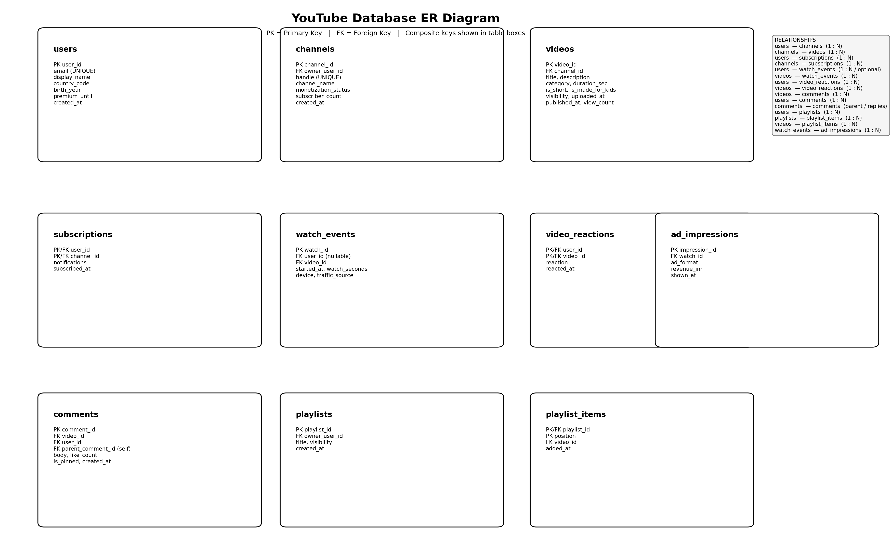

# YouTube Database – ER Diagram

This document describes the relationships between the 10 tables in the YouTube database schema.

## 1. Entity relationship table

| Parent table | Relationship | Child table | Foreign key |
|---|---|---|---|
| USERS | One-to-Many (1:N) | CHANNELS | `owner_user_id` |
| USERS | One-to-Many (1:N) | SUBSCRIPTIONS | `user_id` |
| CHANNELS | One-to-Many (1:N) | SUBSCRIPTIONS | `channel_id` |
| CHANNELS | One-to-Many (1:N) | VIDEOS | `channel_id` |
| USERS | One-to-Many (1:N) | WATCH_EVENTS | `user_id` (nullable) |
| VIDEOS | One-to-Many (1:N) | WATCH_EVENTS | `video_id` |
| USERS | One-to-Many (1:N) | VIDEO_REACTIONS | `user_id` |
| VIDEOS | One-to-Many (1:N) | VIDEO_REACTIONS | `video_id` |
| USERS | One-to-Many (1:N) | COMMENTS | `user_id` |
| VIDEOS | One-to-Many (1:N) | COMMENTS | `video_id` |
| COMMENTS | One-to-Many (1:N) | COMMENTS | `parent_comment_id` |
| USERS | One-to-Many (1:N) | PLAYLISTS | `owner_user_id` |
| PLAYLISTS | One-to-Many (1:N) | PLAYLIST_ITEMS | `playlist_id` |
| VIDEOS | One-to-Many (1:N) | PLAYLIST_ITEMS | `video_id` |
| WATCH_EVENTS | One-to-Many (1:N) | AD_IMPRESSIONS | `watch_id` |

## 2. Primary keys and foreign keys

| Table | Primary key (PK) | Foreign key (FK) |
|---|---|---|
| USERS | `user_id` | — |
| CHANNELS | `channel_id` | `owner_user_id` → USERS |
| VIDEOS | `video_id` | `channel_id` → CHANNELS |
| SUBSCRIPTIONS | (`user_id`, `channel_id`) | `user_id` → USERS; `channel_id` → CHANNELS |
| WATCH_EVENTS | `watch_id` | `user_id` → USERS (nullable); `video_id` → VIDEOS |
| VIDEO_REACTIONS | (`user_id`, `video_id`) | `user_id` → USERS; `video_id` → VIDEOS |
| COMMENTS | `comment_id` | `video_id` → VIDEOS; `user_id` → USERS; `parent_comment_id` → COMMENTS |
| PLAYLISTS | `playlist_id` | `owner_user_id` → USERS |
| PLAYLIST_ITEMS | (`playlist_id`, `position`) | `playlist_id` → PLAYLISTS; `video_id` → VIDEOS |
| AD_IMPRESSIONS | `impression_id` | `watch_id` → WATCH_EVENTS |

## 3. Many-to-many relationships

- **USERS and CHANNELS:** connected through `SUBSCRIPTIONS`.
- **USERS and VIDEOS:** connected through `VIDEO_REACTIONS`.
- **PLAYLISTS and VIDEOS:** connected through `PLAYLIST_ITEMS`.
- **USERS and VIDEOS (viewing activity):** viewing activity is recorded in `WATCH_EVENTS`. Its `user_id` is nullable to support logged-out viewing.

## 4. Relationship notes

- A user can own multiple channels, while each channel has one owner.
- A channel can upload multiple videos, while each video belongs to one channel.
- A user can subscribe to multiple channels, and a channel can have multiple subscribers.
- A video can have multiple watch events, reactions, and comments.
- A comment can be a top-level comment or a reply to another comment.
- A playlist belongs to one user and can contain multiple videos through `PLAYLIST_ITEMS`.
- A watch event can be associated with multiple ad impressions.
