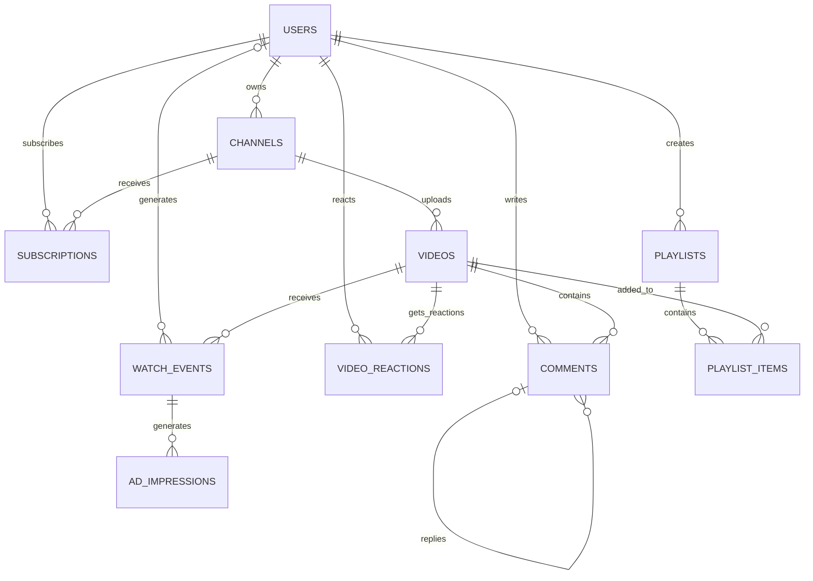

# YouTube Database – Schema Design (Phase 2)

## 1. Introduction

The objective of this phase is to reverse-engineer the existing YouTube database using the provided CSV exports. The database is designed in PostgreSQL under the `youtube` schema.

The design focuses on:
- Data integrity and consistency.
- Proper primary and foreign keys.
- Appropriate data types and constraints.
- Normalization up to 3NF/BCNF.
- Supporting future growth and query optimization.

## 2. Tables and Data Dictionary

### 2.1 Users

**Purpose:** Stores registered user information.

| Column | Data Type | Constraint | Reason |
|---|---|---|---|
| user_id | BIGINT | PK, NOT NULL | Unique user ID |
| email | VARCHAR(255) | UNIQUE, NOT NULL | Unique email |
| display_name | VARCHAR(255) | NOT NULL | User's display name |
| country_code | CHAR(2) | CHECK, NULL | Country identifier |
| birth_year | SMALLINT | CHECK, NULL | Year of birth |
| premium_until | TIMESTAMPTZ | NULL | Premium expiry date |
| created_at | TIMESTAMPTZ | NOT NULL | Account creation time |

**Functional Dependency:**

user_id → email, display_name, country_code, birth_year, premium_until, created_at

**Candidate Keys:** user_id, email.

**Normal Form:** BCNF.

### 2.2 Channels

**Purpose:** Stores creator channel information.

| Column | Data Type | Constraint | Reason |
|---|---|---|---|
| channel_id | BIGINT | PK | Unique channel ID |
| owner_user_id | BIGINT | FK, NOT NULL | Channel owner |
| handle | VARCHAR(100) | UNIQUE, NOT NULL | Unique channel handle |
| channel_name | VARCHAR(255) | NOT NULL | Channel name |
| country_code | CHAR(2) | CHECK, NULL | Country identifier |
| is_verified | BOOLEAN | NOT NULL | Verification status |
| monetization_status | VARCHAR(30) | CHECK, NOT NULL | Monetization status |
| subscriber_count | BIGINT | CHECK, NOT NULL | Subscriber count |
| created_at | TIMESTAMPTZ | NOT NULL | Creation timestamp |

**Functional Dependency:**

channel_id → owner_user_id, handle, channel_name, country_code, is_verified, monetization_status, subscriber_count, created_at

**Candidate Keys:** channel_id, handle.

**Normal Form:** BCNF.

**Redundant Attribute:** subscriber_count can be calculated from subscriptions. It is retained as a cached counter to improve channel-page performance.

### 2.3 Videos

**Purpose:** Stores uploaded videos and their publishing information.

| Column | Data Type | Constraint | Reason |
|---|---|---|---|
| video_id | VARCHAR(11) | PK, CHECK | Unique 11-character video ID |
| channel_id | BIGINT | FK, NOT NULL | Uploading channel |
| title | VARCHAR(500) | NOT NULL | Video title |
| description | TEXT | NULL | Optional description |
| category | VARCHAR(100) | NOT NULL | Video category |
| duration_sec | INTEGER | CHECK, NOT NULL | Video duration |
| is_short | BOOLEAN | NOT NULL | Shorts classification |
| is_made_for_kids | BOOLEAN | NOT NULL | Child-directed content |
| visibility | VARCHAR(20) | CHECK, NOT NULL | Publishing visibility |
| uploaded_at | TIMESTAMPTZ | NOT NULL | Upload timestamp |
| published_at | TIMESTAMPTZ | NULL | Publishing timestamp |
| view_count | BIGINT | CHECK, NOT NULL | Total view count |

**Functional Dependency:**

video_id → channel_id, title, description, category, duration_sec, is_short, is_made_for_kids, visibility, uploaded_at, published_at, view_count

**Candidate Key:** video_id.

**Normal Form:** BCNF.

**Redundant Attributes:**
- view_count can be calculated from watch_events but is retained as a cached counter for performance.
- is_short is related to duration_sec but is retained because Shorts classification is a separate product attribute.

### 2.4 Subscriptions

**Purpose:** Stores relationships between users and channels.

| Column | Data Type | Constraint | Reason |
|---|---|---|---|
| user_id | BIGINT | PK, FK | Subscriber |
| channel_id | BIGINT | PK, FK | Subscribed channel |
| notifications | VARCHAR(20) | CHECK, NOT NULL | Notification preference |
| subscribed_at | TIMESTAMPTZ | NOT NULL | Subscription timestamp |

**Primary Key:** (user_id, channel_id)

**Functional Dependency:**

(user_id, channel_id) → notifications, subscribed_at

**Normal Form:** BCNF.

### 2.5 Watch Events

**Purpose:** Stores individual video viewing events.

| Column | Data Type | Constraint | Reason |
|---|---|---|---|
| watch_id | BIGINT | PK | Unique watch event |
| user_id | BIGINT | FK, NULL | Signed-in viewer, nullable for logged-out users |
| video_id | VARCHAR(11) | FK, NOT NULL | Watched video |
| started_at | TIMESTAMPTZ | NOT NULL | Watch start time |
| watch_seconds | INTEGER | CHECK, NOT NULL | Watch duration |
| device | VARCHAR(30) | CHECK, NOT NULL | Viewing device |
| traffic_source | VARCHAR(50) | CHECK, NOT NULL | Traffic source |

**Functional Dependency:**

watch_id → user_id, video_id, started_at, watch_seconds, device, traffic_source

**Candidate Key:** watch_id.

**Normal Form:** BCNF.

### 2.6 Video Reactions

**Purpose:** Stores user likes and dislikes.

| Column | Data Type | Constraint | Reason |
|---|---|---|---|
| user_id | BIGINT | PK, FK | Reacting user |
| video_id | VARCHAR(11) | PK, FK | Related video |
| reaction | VARCHAR(10) | CHECK, NOT NULL | LIKE or DISLIKE |
| reacted_at | TIMESTAMPTZ | NOT NULL | Reaction timestamp |

**Primary Key:** (user_id, video_id)

**Functional Dependency:**

(user_id, video_id) → reaction, reacted_at

**Normal Form:** BCNF.

### 2.7 Comments

**Purpose:** Stores comments and replies.

| Column | Data Type | Constraint | Reason |
|---|---|---|---|
| comment_id | BIGINT | PK | Unique comment |
| video_id | VARCHAR(11) | FK, NOT NULL | Related video |
| user_id | BIGINT | FK, NOT NULL | Comment author |
| parent_comment_id | BIGINT | Self-FK, NULL | Parent comment for replies |
| body | TEXT | NOT NULL | Comment content |
| like_count | BIGINT | CHECK, NOT NULL | Comment likes |
| is_pinned | BOOLEAN | NOT NULL | Pinned status |
| created_at | TIMESTAMPTZ | NOT NULL | Creation timestamp |

**Functional Dependency:**

comment_id → video_id, user_id, parent_comment_id, body, like_count, is_pinned, created_at

**Normal Form:** BCNF.

### 2.8 Playlists

**Purpose:** Stores user-created playlists.

| Column | Data Type | Constraint | Reason |
|---|---|---|---|
| playlist_id | BIGINT | PK | Unique playlist |
| owner_user_id | BIGINT | FK, NOT NULL | Playlist owner |
| title | VARCHAR(255) | NOT NULL | Playlist title |
| visibility | VARCHAR(20) | CHECK, NOT NULL | Playlist visibility |
| created_at | TIMESTAMPTZ | NOT NULL | Creation timestamp |

**Functional Dependency:**

playlist_id → owner_user_id, title, visibility, created_at

**Normal Form:** BCNF.

### 2.9 Playlist Items

**Purpose:** Stores videos inside playlists and their ordering.

| Column | Data Type | Constraint | Reason |
|---|---|---|---|
| playlist_id | BIGINT | PK, FK | Parent playlist |
| position | INTEGER | PK, CHECK | Position in playlist |
| video_id | VARCHAR(11) | FK, NOT NULL | Added video |
| added_at | TIMESTAMPTZ | NOT NULL | Addition timestamp |

**Primary Key:** (playlist_id, position)

**Unique Constraint:** (playlist_id, video_id)

**Functional Dependency:**

(playlist_id, position) → video_id, added_at

**Normal Form:** BCNF.

### 2.10 Ad Impressions

**Purpose:** Stores advertisements displayed during video views.

| Column | Data Type | Constraint | Reason |
|---|---|---|---|
| impression_id | BIGINT | PK | Unique impression |
| watch_id | BIGINT | FK, NOT NULL | Related watch event |
| ad_format | VARCHAR(30) | CHECK, NOT NULL | Advertisement format |
| revenue_inr | NUMERIC(12,4) | CHECK, NOT NULL | Revenue in INR |
| shown_at | TIMESTAMPTZ | NOT NULL | Advertisement timestamp |

**Functional Dependency:**

impression_id → watch_id, ad_format, revenue_inr, shown_at

**Normal Form:** BCNF.

---

## 3. Foreign Keys and Delete Rules

| Child Table | Foreign Key | ON DELETE | Reason |
|---|---|---|---|
| channels | owner_user_id → users | RESTRICT | Protect channel ownership |
| videos | channel_id → channels | RESTRICT | Preserve video records |
| subscriptions | user_id → users | CASCADE | Remove subscriptions of deleted users |
| subscriptions | channel_id → channels | CASCADE | Remove subscriptions to deleted channels |
| watch_events | user_id → users | SET NULL | Preserve anonymous watch records |
| watch_events | video_id → videos | RESTRICT | Protect watch history |
| video_reactions | user_id → users | CASCADE | Remove user reactions |
| video_reactions | video_id → videos | CASCADE | Remove reactions with deleted videos |
| comments | video_id → videos | RESTRICT | Preserve comment history |
| comments | user_id → users | RESTRICT | Protect comment ownership |
| comments | parent_comment_id → comments | SET NULL | Preserve replies |
| playlists | owner_user_id → users | CASCADE | Remove playlists with deleted owners |
| playlist_items | playlist_id → playlists | CASCADE | Remove playlist items |
| playlist_items | video_id → videos | RESTRICT | Protect referenced videos |
| ad_impressions | watch_id → watch_events | RESTRICT | Preserve financial audit records |

These are proposed deletion policies. Production account deletion may require anonymization or soft deletion instead of physical deletion.

---

## 4. CHECK Constraints

The following constraints maintain data validity.

1. User country code must contain two uppercase letters.
2. User birth year must be between 1900 and 2100.
3. Channel handle must begin with @.
4. Channel country code must contain two uppercase letters.
5. Subscriber count cannot be negative.
6. Monetization status must belong to an approved list.
7. Video ID must contain exactly 11 characters.
8. Video duration must be greater than zero.
9. Video visibility must be PUBLIC, UNLISTED, PRIVATE or SCHEDULED.
10. Video view count cannot be negative.
11. Shorts duration must not exceed 60 seconds, subject to validation against the applicable business rule.
12. Notification preference must be NONE, PERSONALIZED or ALL.
13. Watch seconds cannot be negative.
14. Device must belong to an approved list.
15. Reaction must be LIKE or DISLIKE.
16. Comment like count cannot be negative.
17. Playlist visibility must be PUBLIC, UNLISTED or PRIVATE.
18. Playlist position must be greater than zero.
19. Advertisement revenue cannot be negative.

Additional cross-table business rules:
- A logged-out viewer must be allowed to generate watch events.
- Premium viewers must not receive advertisements.
- Replies should not be pinned.
- Watch duration exceeding video duration requires investigation, but should not automatically be rejected because replaying may increase accumulated watch time.

Allowed values for categories, devices, traffic sources, ad formats and monetization status must be verified against the complete seed data before enforcing CHECK constraints.

---

## 5. ER Diagram

The following Mermaid diagram represents the database relationships.



### Relationships and Cardinalities

| Relationship | Cardinality |
|---|---|
| Users → Channels | 1:N |
| Channels → Videos | 1:N |
| Users ↔ Channels through Subscriptions | M:N |
| Users → Watch Events | 1:N, optional user |
| Videos → Watch Events | 1:N |
| Users ↔ Videos through Video Reactions | M:N |
| Users → Comments | 1:N |
| Videos → Comments | 1:N |
| Comments → Replies | 1:N |
| Users → Playlists | 1:N |
| Playlists → Playlist Items | 1:N |
| Videos → Playlist Items | 1:N |
| Watch Events → Ad Impressions | 1:N |

---

## 6. Normalization Analysis

All tables are designed to satisfy at least Third Normal Form (3NF), and under the listed functional dependencies, BCNF.

| Table | Primary Key | Functional Dependency | Normal Form |
|---|---|---|---|
| users | user_id | user_id → all other attributes | BCNF |
| channels | channel_id | channel_id → all other attributes | BCNF |
| videos | video_id | video_id → all other attributes | BCNF |
| subscriptions | user_id, channel_id | (user_id, channel_id) → other attributes | BCNF |
| watch_events | watch_id | watch_id → all other attributes | BCNF |
| video_reactions | user_id, video_id | (user_id, video_id) → other attributes | BCNF |
| comments | comment_id | comment_id → all other attributes | BCNF |
| playlists | playlist_id | playlist_id → all other attributes | BCNF |
| playlist_items | playlist_id, position | (playlist_id, position) → other attributes | BCNF |
| ad_impressions | impression_id | impression_id → all other attributes | BCNF |

### Redundant and Derived Attributes

**1. channels.subscriber_count**

Can be calculated by counting subscriptions for each channel. Retained as a cached counter to improve channel-page performance.

**2. videos.view_count**

Can be calculated from watch_events. Retained as a cached counter because calculating views from a massive event table on every request would be expensive.

**3. videos.is_short**

Related to duration_sec but retained separately because Shorts classification is a product attribute and should not be inferred solely from duration.

These cached attributes must be updated consistently to avoid discrepancies.

---

## 7. Data Loading and Validation

### 7.1 Loading Order

The CSV files are loaded using PostgreSQL `\copy` in the following order:

1. users.csv
2. channels.csv
3. videos.csv
4. subscriptions.csv
5. watch_events.csv
6. video_reactions.csv
7. comments.csv
8. playlists.csv
9. playlist_items.csv
10. ad_impressions.csv

After loading, ANALYZE is executed to update query planner statistics.

### 7.2 Row Count Verification

| Table | Imported Rows |
|---|---|
| users | Pending verification |
| channels | Pending verification |
| videos | Pending verification |
| subscriptions | Pending verification |
| watch_events | Pending verification |
| video_reactions | Pending verification |
| comments | Pending verification |
| playlists | Pending verification |
| playlist_items | Pending verification |
| ad_impressions | Pending verification |

Actual counts must be recorded after importing the complete CSV files.

### 7.3 Integrity Checks

**Check 1: Nobody watched a video before it was uploaded.**

```sql
SELECT w.watch_id, w.video_id
FROM watch_events w
JOIN videos v ON w.video_id = v.video_id
WHERE w.started_at < v.uploaded_at;
```

Expected result: 0 rows, subject to investigation of any historical timestamp inconsistencies.

**Check 2: Watch duration validation.**

```sql
SELECT w.watch_id, w.watch_seconds, v.duration_sec
FROM watch_events w
JOIN videos v ON w.video_id = v.video_id
WHERE w.watch_seconds > v.duration_sec;
```

Any results require investigation because replayed content may cause accumulated watch time to exceed video duration.

**Check 3: Duplicate videos in playlists.**

```sql
SELECT playlist_id, video_id, COUNT(*)
FROM playlist_items
GROUP BY playlist_id, video_id
HAVING COUNT(*) > 1;
```

Expected result: 0 rows. A UNIQUE constraint on (playlist_id, video_id) can prevent duplicates.

### 7.4 Data Problems and Observations

- Some users have NULL premium_until values because no Premium expiry is recorded.
- Some users have NULL birth_year values because their birth year is not provided.
- Some videos have NULL descriptions because descriptions are optional.
- Some videos have NULL published_at values because they have not been published.
- Some watch events have NULL user_id values because logged-out viewers can watch videos.
- Some comments have NULL parent_comment_id values because they are top-level comments.
- Cached view and subscriber counts may differ from counts calculated from event and subscription tables; this requires validation.
- Complete distinct-value checks are required before enforcing restrictions on categories, devices, traffic sources and ad formats.

### 7.5 Indexes

No manually created performance indexes have been added during Phase 2.

PostgreSQL automatically creates indexes for:
- Primary keys.
- UNIQUE constraints.

These include the primary-key indexes on all ten tables and unique indexes on users.email, channels.handle and playlist_items(playlist_id, video_id), if that additional constraint is implemented.

Additional indexes will be considered in Phase 4 after measuring baseline query performance.

---

## 8. Conclusion

The YouTube database has been designed with ten related tables, appropriate data types, primary keys, foreign keys, uniqueness rules and validation constraints.

The schema supports registered and logged-out viewers, channel ownership, video publishing, subscriptions, reactions, comments, playlists, watch events and advertisement revenue.

The design maintains data integrity while retaining selected cached counters for performance. The next phase will focus on importing the complete seed data, validating row counts and integrity checks, and benchmarking the 30 important SQL queries.
